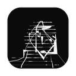

# SketchCam

A programmable camera and canvas for live drawing, reactive typography and
performance. Turn your webcam into procedural portraits, paint with gestures,
combine video and text, and send the result to other apps as a virtual camera.

## Get SketchCam

**[Download the prerelease](https://github.com/languel/sketchcam/releases)** ·
macOS 26 or newer · [MIT license](LICENSE)

Unzip the download, move **SketchCam.app** to **Applications**, and open it.
To use the virtual camera, activate the Camera Extension in SketchCam, approve
it in System Settings, and restart the app. Then select **SketchCam** as the
camera in your video app.

See [Getting started](docs/getting-started.md) for installation and a first session.

## What you can make

- Layer cameras, recorded video, effects, drawings, paper and web content.
- Draw live portraits with **Portrait**, **Yarn**, **Wrap** and **Line walk**.
- Paint on an interactive **Ink** canvas, with paper materials and undo/redo.
- Turn microphone speech or scripts into styled captions and animated text.
  Save Text looks, fade words, or hold headline cards until new text arrives.
- Connect loudness, gestures, stroke events and voice commands to creative actions.
- Share the composition through the virtual camera or a separate output window.

Camera/microphone capture, speech model loading and gesture arming use explicit
controls. The first speech setup may download a model; recognition then runs
locally. The virtual camera carries video, not audio.

## Learn more

- [Feature reference](docs/features.md)
- [Audio, text and voice commands](docs/audio-text-streams.md)
- [Motion controls, gesture sequences and MCP](docs/motion-tools.md)
- [Portrait drawing](docs/portrait-drawing.md)
- [Build from source](docs/development.md)
- [CI builds and releases](docs/ci-distribution.md) · [Release procedure](docs/releasing.md)

This is an early prerelease for experimentation and feedback.
[Report an issue](https://github.com/languel/sketchcam/issues) with your macOS
version, SketchCam version and steps to reproduce the problem.
